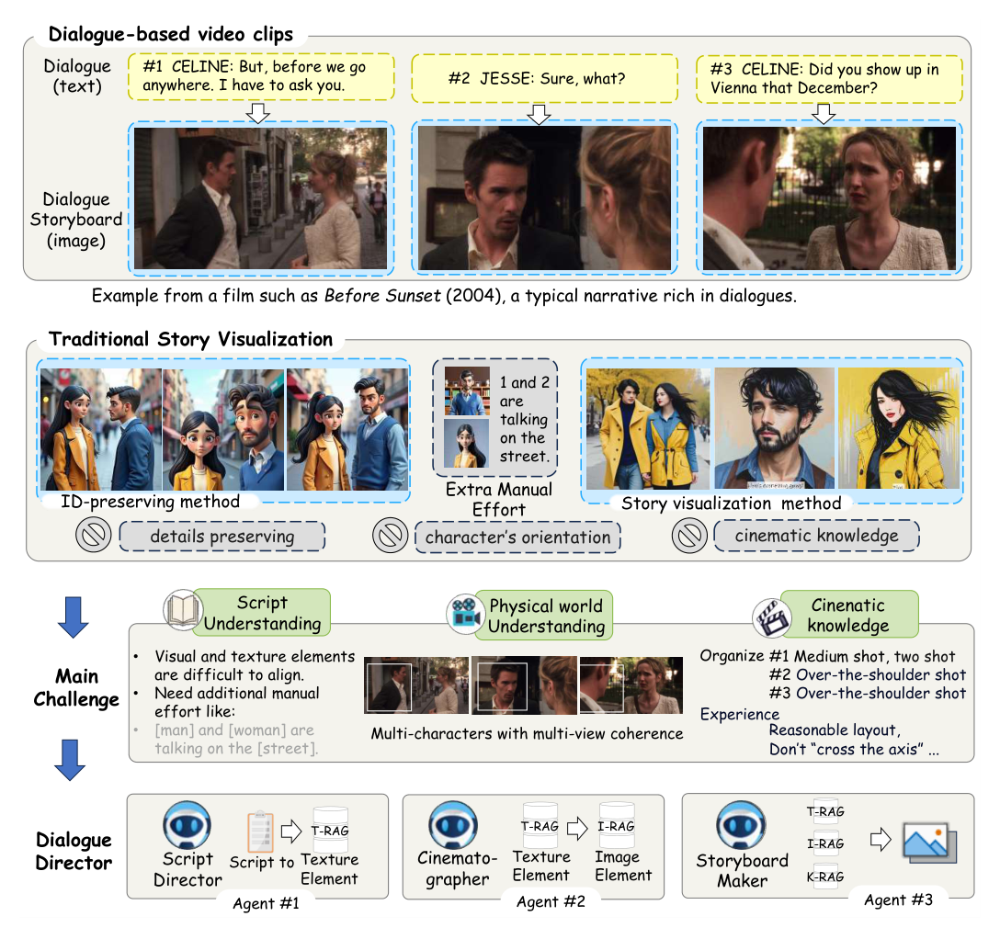
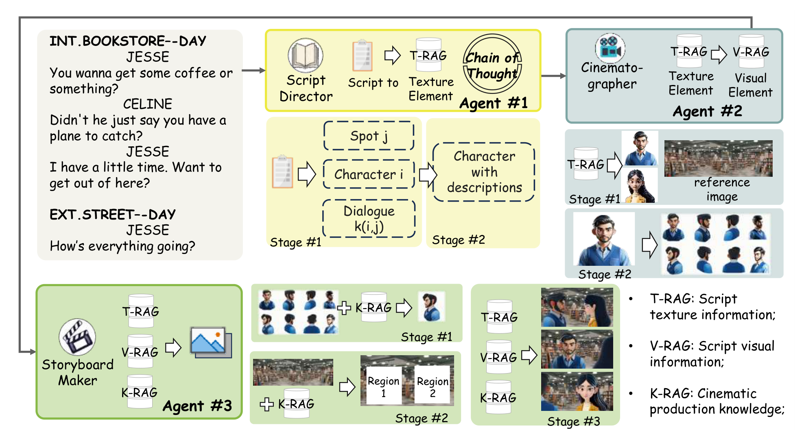
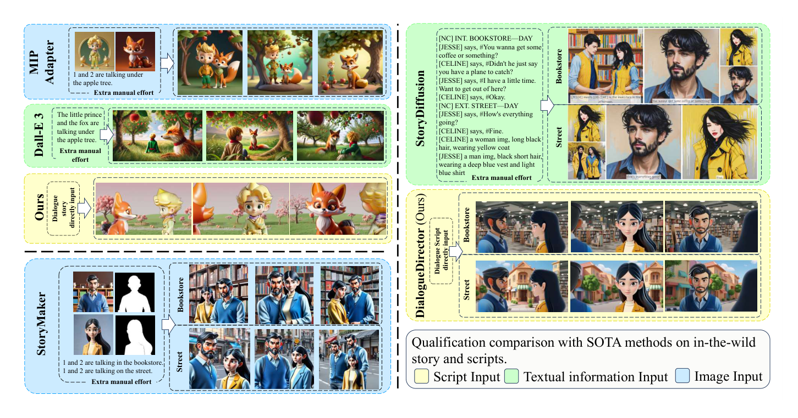
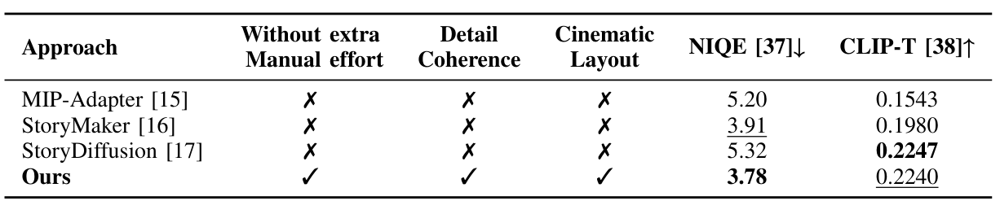
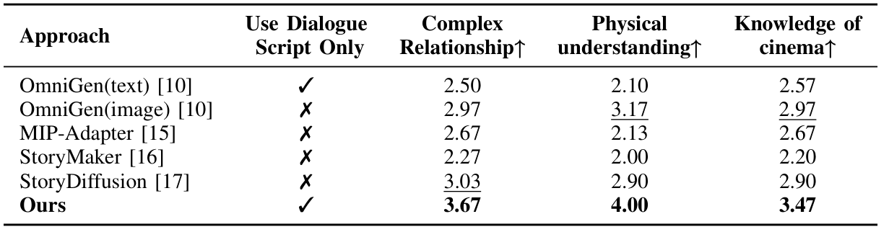
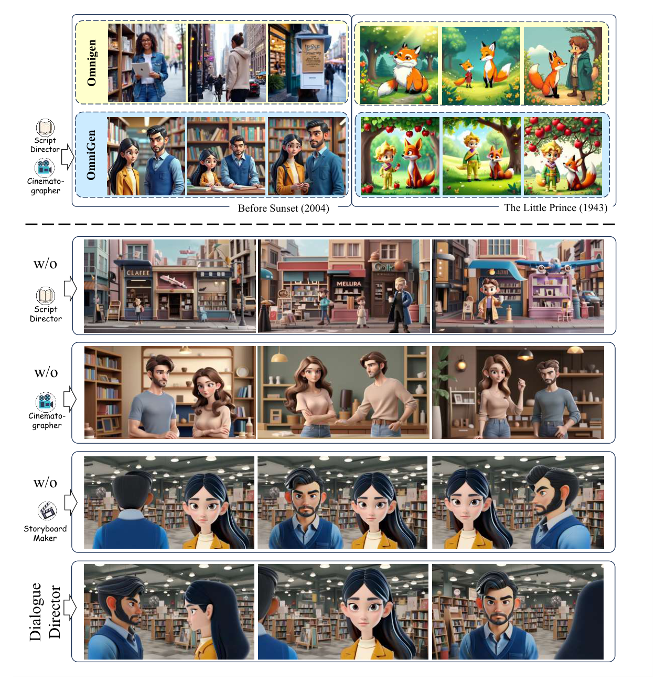
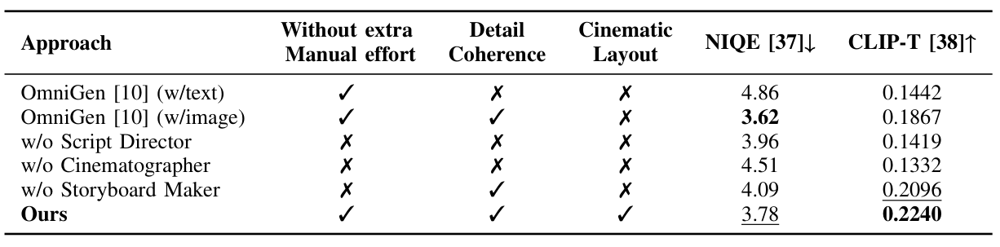

# Dialogue Director：从对白剧本到具有电影语言的多视角分镜

Paper Reading 是从个人角度进行的一些总结分享，受到个人关注点的侧重和实力所限，可能有理解不到位的地方。具体的细节还需要以原文的内容为准，博客中的图表若未另外说明则均来自原文。

| 论文概况 | 详细 |
| --- | --- |
| 标题 | 《Dialogue Director: Bridging the Gap in Dialogue Visualization for Multimodal Storytelling》 |
| 作者 | Min Zhang、Zilin Wang、Liyan Chen、Kunhong Liu、Juncong Lin |
| 发表会议 | IEEE International Conference on Multimedia and Expo（ICME） |
| 会议等级 | CCF B 类（[CCF 官方目录](https://www.ccf.org.cn/Academic_Evaluation/CGAndMT/)） |
| 发表年份 | 2025 |
| 论文代码 | 未获取；上传原文未列出代码仓库链接 |

作者单位：

1. 厦门大学电影学院（School of Film, Xiamen University）：Min Zhang、Zilin Wang、Liyan Chen、Kunhong Liu。
2. 厦门大学信息学院（School of Informatics, Xiamen University）：Juncong Lin。

Liyan Chen 与 Kunhong Liu 为通讯作者。原文链接：[IEEE DOI](https://doi.org/10.1109/ICME59968.2025.11210229)；预印本链接：[arXiv:2412.20725](https://arxiv.org/abs/2412.20725)。预印本于 2024 年提交，本笔记以用户上传的 ICME 2025 正式发表版本为依据。

## 研究动机

对白可视化是多模态故事生成中的重要问题，表现为将以人物对话为主的剧本转换为连续分镜，使读者能够从画面中理解人物关系、场景变化与叙事进展。然而，现有故事可视化方法通常依赖已经整理好的视觉描述，直接面对对白时，存在叙事信息稀疏、人物跨视角细节不一致以及镜头组织缺少电影知识等问题。

对白中的说话内容并不等同于画面说明。一句邀请对方离开的台词，可能隐含人物互动与场景转移，却没有完整指定服装、站位、视线和摄影机角度。人工把剧本改写成逐幅提示词可以补充这些信息，但会增加制作负担；只保持人物面孔相似，也不能保证人物转身后衣着一致、交谈双方朝向合理。进一步地，连续镜头还需要遵守空间关系与轴线等电影惯例，单幅图像的质量无法直接代表整段对白是否容易理解。本文关注的空白是：如何从未经逐幅视觉改写的对白剧本出发，同时获得可信的人物多视角表示与连贯的电影式镜头序列。

## 文章贡献

针对对白剧本缺少显式视觉信息、人物跨镜头一致性难以保持以及电影知识难以融入生成过程的问题，本文提出 Dialogue Visualization 任务，并设计了无需额外训练的 Dialogue Director 框架。其核心是让剧本导演、摄影师和分镜制作师分别承担文本理解、视觉参考构建与镜头编排，通过结构化信息和检索增强连接各阶段。剧本导演提取并细化人物、地点与对白，摄影师生成参考图像并扩展人物视角，分镜制作师结合电影知识选择视角、规划布局与合成画面。本文还将图像质量、图文一致性和电影专业背景参与者的人类评价结合起来，在真实电影剧本与童话故事上验证了这套协作流程的有效性。

## 本文方法

### 任务与整体工作流程

整体流程的目标是将对白中的叙事线索转化为可检索的文字与图像材料，再据此组织具有镜头变化的分镜序列。本文的任务定位和三个主要挑战如下图所示（原文图 1）。

图中将挑战对应到剧本理解、物理世界理解与电影知识三个方面：知道角色是谁，还需要知道他们如何面对彼此，以及摄影机应如何呈现这种关系。这里的“物理世界理解”主要落实为朝向、跨视角外观和场景细节的连续性；输出对象是分镜图像序列。

Dialogue Director 的具体数据流如下图所示（原文图 2）。

图中的黄色部分负责从剧本得到文字元素，蓝色部分把文字变成视觉参考，绿色部分完成视角选择、区域规划与分镜合成。按图 2 的标记，T-RAG 提供剧本文字信息，V-RAG 提供剧本对应的视觉信息，K-RAG 提供电影制作知识，后面的阶段可以同时利用这些材料。

这套设计将需要保持的内容逐步固定下来：文字记录明确人物与情节，参考图像明确外观，多视角图像明确可用朝向，布局再明确人物与环境的位置。本文用 Chain-of-Thought 辅助剧本分析，用 RAG 连接上下文与参考材料；后续公式主要描述各阶段的输入输出接口，阅读时应沿着信息流理解它们。原文复用了部分集合下标，下面保留原式记法，不把下标上界解释成实验样本规模。

三个智能体与材料之间的对应关系可以整理如下。

| 组件 | 功能与信息流 |
| --- | --- |
| Script Director（剧本导演） | 读取剧本，提取并丰富人物、地点和对白，建立文字上下文 |
| Cinematographer（摄影师） | 根据文字生成参考图，扩展人物视角，提供视觉上下文 |
| Storyboard Maker（分镜制作师） | 综合对白、视觉参考与电影知识，选择视角、规划区域并合成分镜 |

从这张对应表可以理解，三个智能体的划分依据是制作职责。本文所说的无需额外训练，是利用现有语言模型与视觉生成模型完成协作；系统仍然使用预训练模型的生成能力。阅读这项工作时，关键是观察文字信息如何成为视觉约束，以及视觉约束如何参与镜头组织。

### 从剧本中提取人物、地点与对白

剧本导演的初始解析用于将整段剧本文字拆成可供后续处理的叙事元素。本文的结构化提取公式如下（原文式 1）：

$$
\left\{\{c^i\}_{i=0}^{n},\{p^j\}_{j=0}^{n},\{d^l\}_{l=0}^{k}\right\}
=\chi^{(0)}\left(S,I^{(0)}\right).
$$

其中各符号的含义如下。

| 符号 | 含义 |
| --- | --- |
| $S$ | 输入的对白剧本 |
| $\chi^{(0)}$ | 剧本导演的初始提取阶段 |
| $I^{(0)}$ | 指导初始解析的指令 |
| $c^i$、$p^j$、$d^l$ | 提取出的人物、地点与对白元素 |
| $i$、$j$、$l$ | 对应元素的索引 |

直观上，这一步相当于先整理剧本中有哪些人物、发生在哪些地方、包含哪些对白，再把这些信息交给后续模块。分开记录人物与地点，可以使同一角色跨地点出现时仍然对应同一叙事对象，也便于分镜阶段查询当前对白所处的场景。

以图 2 中的《爱在日落黄昏时》片段为例，JESSE 与 CELINE 是人物，BOOKSTORE 与 STREET 是地点，邀请喝咖啡、讨论是否离开以及街上的问候是不同的对白内容。场景标题从室内书店变为室外街道，是画面需要切换环境的直接依据。这些对象被提取后，输出给描述细化阶段，并成为后续文字检索的基础材料。

这里的处理还保留了对白与叙事对象的联系。若只将整页文字压缩成“两个人在交谈”，书店内的邀请和街道上的问候就容易失去区别；将人物、地点与对白分别整理后，系统可以围绕当前片段调用对应的信息。这个例子帮助理解本文为什么先建立结构化上下文，再进入图像生成：后续镜头需要持续利用此前已经确定的角色和场景。

### 由粗到细补充可视化描述

描述细化用于把稀疏的角色信息转成更适合图像生成的文字条件。本文以人物集合为例给出了更新公式（原文式 2）：

$$
\{\hat c^0,\hat c^1,\ldots,\hat c^n\}
=\chi^{(1)}\left(S,\{c^i\}_{i=0}^{n},I^{(1)}\right).
$$

其中各符号的含义如下。

| 符号 | 含义 |
| --- | --- |
| $\chi^{(1)}$ | 剧本导演的描述细化阶段 |
| $\hat c^i$ | 细化后的人物描述 |
| $I^{(1)}$ | 指导细化过程的指令 |
| $S$、$\{c^i\}_{i=0}^{n}$ | 原剧本与前一阶段提取的人物集合 |

直观上，同一个角色从“剧本中出现的名字”变成“可以据以绘制形象的描述”。本文采用由粗到细的策略补充元素，使生成模型获得更明确的外观与上下文条件；图 2 中的人物描述框就位于初始元素与视觉参考之间。

这里保留原剧本作为输入，使细化仍然能够利用人物对白和场景背景。文本描述被存储后，摄影师可反复检索同一份信息，避免不同镜头分别解释同一角色而造成外观漂移。原文文字同时讨论人物与地点的描述丰富化，式 2 显式展示的是人物分支；细化后的信息将作为下一阶段生成参考图像的条件。

“由粗到细”可以理解为在叙事元素已经确定之后，再补充可视化所需要的属性。图中的人物描述就是这样一种中间结果：它既与剧本中的角色对应，又能被下一阶段的生成模型使用。这使剧本导演承担了从语言叙事到视觉条件的转换工作，读者也可以通过人物描述、参考图像与最终画面之间的联系追踪信息如何逐步具体化。

### 将文字元素转换为人物与场景参考图

摄影师的初始生成用于建立人物和地点的视觉参考，把文字属性落实成可重复使用的图像。本文的参考图像生成公式如下（原文式 3）：

$$
\left\{\{\mathrm{cimg}^{i}\}_{i=0}^{n},\{\mathrm{pimg}^{j}\}_{j=0}^{n}\right\}
=\Gamma^{(0)}\left(\{\hat c^i\}_{i=0}^{n}+\theta_{\mathrm{base}},\{p^j\}_{j=0}^{n}\right).
$$

其中各符号的含义如下。

| 符号 | 含义 |
| --- | --- |
| $\Gamma^{(0)}$ | 摄影师生成初始参考图像的阶段 |
| $\mathrm{cimg}^{i}$、$\mathrm{pimg}^{j}$ | 人物参考图像与地点参考图像 |
| $\theta_{\mathrm{base}}$ | 基础提示条件，如肖像朝向、人物取景方式 |
| $\hat c^i$、$p^j$ | 上游提供的人物描述与地点信息 |

直观上，角色的发型、服装和视觉风格在这一阶段得到具体表现，地点也有了可供分镜调用的环境参考。式中的加号表示在描述上加入基础提示条件，原文将其解释为朝向、取景等提示，不应把它理解成模型参数的数值相加。

文字条件能够表达属性，图像参考则能同时保留这些属性的具体组合。后续阶段因此可以围绕已有外观组织不同镜头，而不必在每幅画面中重新从文字生成角色。此阶段接收剧本导演输出的描述，人物图像继续送入多视角生成，场景图像则保留给布局和最终合成使用。

人物参考和地点参考在流程中发挥的作用不同。人物参考为后续朝向变化提供外观起点，地点参考为镜头中的环境提供材料；两者在最终画面中重新汇合。图 2 因此分别展示了角色肖像与书店背景，这样的中间材料组织，也便于理解同一批人物为什么可以继续出现在后面的地点与镜头中。

### 从人物参考图构建多视角图像库

多视角生成用于提供同一角色在不同朝向下的参考，使对话中的过肩镜头等构图有可用的视觉材料。本文的多视角扩展公式如下（原文式 4）：

$$
\{\mathrm{cimg}^{i}_{x}\}_{i=0}^{n}
=\Gamma^{(1)}\left(\{\mathrm{cimg}^{i}\}_{i=0}^{n}\right),
\qquad x\in[0,7].
$$

其中 $\Gamma^{(1)}$ 是多视角生成阶段，$\mathrm{cimg}^{i}_{x}$ 是人物 $i$ 在视角 $x$ 下的图像。输入沿用上一阶段的人物参考图；原文将视角索引写为 $x\in[0,7]$，图 2 展示了人物从不同方向观察时的参考形象。

直观上，单张人物图被扩展为可供镜头选择的多方向素材。在对白场景中，一方正面面对摄影机时，另一方可能只露出侧面或背部，维持这些方向之间的服装与发型联系，是连续镜头的重要条件。

本文使用多视角扩散方法完成这一转换，实验涉及 MV-Adapter 与 Hunyuan3D-1 的第一阶段。这里利用的是多视角人物图像生成能力，系统随后将这些图像交给分镜制作师选择。多视角库接收已确定外观的参考图，将人物身份与可用朝向一起传递给下一阶段。

给出一个简单的索引例子，沿用图 2 的两位人物，并按原式理解每位人物对应的视角编号：当分镜需要第一位人物的某个侧向图像时，就从该人物的多视角材料中选取对应编号；切换到另一位人物时，再查询另一组人物材料。这里示意的是原式的索引用法，不涉及额外的实验结果。可以看到，人物索引负责区分角色，视角索引负责区分观察方向，分镜阶段需要同时确定这两层信息。

### 根据对白选择人物视角

视角选择用于把“角色有哪些朝向”转换为“当前对白应使用哪个朝向”。本文的视角选择公式如下（原文式 5）：

$$
x^{(i,j)}=\zeta^{(0)}\left(D^{(i,j)},\{\mathrm{cimg}^{i}_{x}\}_{i=0}^{n},I^{(2)}\right).
$$

其中各符号的含义如下。

| 符号 | 含义 |
| --- | --- |
| $\zeta^{(0)}$ | 分镜制作师的视角选择阶段 |
| $D^{(i,j)}$ | 当前需要可视化的对白片段 |
| $x^{(i,j)}$ | 为对应对白选择的视角索引 |
| $I^{(2)}$ | 指导视角选择的指令 |

直观上，摄影师提供候选素材，分镜制作师依据当前对白决定使用哪一种。式中的人物图像集合沿用上一节，K-RAG 在流程图中为这一选择提供电影制作知识，使视角安排能够联系人物之间的对话关系。

以图 2 的书店交谈为例，系统需要在双人画面与面向某位角色的镜头之间组织切换。过肩镜头既展示当前被关注的人物，也保留另一人的方位线索，因此需要与对话双方的相对位置对应。本文将电影知识接入这个决策过程，所选视角将继续约束下一步的人物放置与画面区域规划。

图 1 中的中景双人镜头与随后两个过肩镜头，给出了这种镜头组织的直观参照。双人画面让观众看到交谈双方的关系，视角切换则把注意力转向其中一方；人物面向哪里，仍要与前一镜头建立的空间关系衔接。本文把这样的电影制作知识引入分镜阶段，使模型的视角选择与对白语境发生联系。

### 规划人物与场景的布局边界

布局规划用于给人物与环境安排画面区域，使选出的朝向能够形成清楚的对话构图。本文的边界计算公式如下（原文式 6）：

$$
B_{x}^{(i,j)}=\zeta^{(1)}\left(D^{(i,j)},\{\mathrm{cimg}^{i}_{x}\}_{i=0}^{n},\{\mathrm{pimg}^{j}\}_{j=0}^{n},I^{(3)}\right).
$$

其中各符号的含义如下。

| 符号 | 含义 |
| --- | --- |
| $B_{x}^{(i,j)}$ | 对应对白与视角下的人物、场景布局边界 |
| $\zeta^{(1)}$ | 分镜制作师的布局规划阶段 |
| $I^{(3)}$ | 指导区域与位置安排的指令 |

其余输入沿用前文，分别是对白、人物视图和地点参考图。直观上，上一阶段解决看向人物的哪个方向，这一阶段进一步解决人物位于画面的什么位置，以及环境与人物如何共同构成镜头。

图 2 将该过程画成背景上的 Region 1 与 Region 2，表现了场景中不同人物区域的规划。原文强调这些边界负责管理人物位置，并让关键视觉元素处于画面关注范围；电影知识同时参与布局，使连续画面中的人物关系与朝向具有叙事连贯性。布局阶段综合前面取得的对白和视觉材料，输出边界给最终的分镜合成阶段。

视角和布局在这里连续发生，也容易在阅读中被混为同一步。结合流程图看，前者从已有材料中确定人物以何种朝向出现，后者则将人物与背景组织在同一画面中。把两者分开描述，可以看清分镜制作师如何逐步缩小最终画面的安排空间，也能对应后文删除该组件时出现的朝向与布局问题。

### 合成连续分镜并保留对白上下文

最终合成用于将选好的视图、场景、区域边界和对白整合为分镜序列。本文的合成公式如下（原文式 7）：

$$
V^{K'}=\zeta^{(2)}\left(\{\mathrm{cimg}^{i}_{x}\}_{i=0}^{n},B_{x}^{(i,j)},\{\mathrm{pimg}^{j}\}_{j=0}^{n},D^{(i,j)},I^{(4)}\right).
$$

其中各符号的含义如下。

| 符号 | 含义 |
| --- | --- |
| $V^{K'}$ | 输出的电影式分镜序列 |
| $\zeta^{(2)}$ | 分镜制作师的最终合成阶段 |
| $I^{(4)}$ | 指导最终合成的指令 |

其中人物视图、布局边界、地点图像与对白都来自前述阶段。直观上，这一步把“画谁、从哪里看、放在哪里、正在说什么”汇合到同一组画面中，原文还讨论了对白文字与场景注释等元数据的结合。

沿着书店到街道的例子看，剧本解析保留场景切换，描述与参考图保持人物外观，多视角库提供不同方向的人物，分镜制作师再组织镜头关系。因此，跨地点变化的是环境，跨镜头变化的是取景和朝向，角色外观与对白联系仍由上游材料约束。最终合成接收整个流程的结果，输出可供观看的分镜序列；三个智能体的分工也使其中部分阶段能够用于其他图像生成模型。

从式 1 到式 7，输入逐步从整段剧本变为结构化元素、描述、图像、视角选择与布局边界，最终汇合成分镜。前一阶段的结果被后续阶段继续使用，是本文保持上下文联系的主要组织方式。这样阅读公式，也能把各智能体的名称与实际处理对象对应起来，避免只记住“三个智能体协作”而忽略它们之间传递的内容。

## 实验结果

### 实验设置与评价口径

本文使用 GPT-4 承担剧本导演与分镜制作工作，基于 Stable Diffusion 1.5 的模型生成初始参考，并使用 MV-Adapter 和 Hunyuan3D-1 第一阶段构建多视角人物材料，实验运行于单张 NVIDIA RTX 3090 Ti 24 GB 显卡。输入包括《爱在日落黄昏时》《小王子》和安徒生童话《海的女儿》等富含对白的剧本或故事，长文本按页拆分，对比涉及 StoryDiffusion、MIP-Adapter、StoryMaker、OmniGen 和 DALL-E 3，但各结果表覆盖的方法不同。

NIQE 越低表示图像质量评价越好，CLIP-T 越高表示描述文字与视觉内容越一致；电影知识的应用由人工评分评估。原文认为 CLIP-I 不适合直接评价人物侧视图外观，也没有把 PSNR 或 SSIM 作为主要感知质量指标，因此下文分别阅读图像质量、图文一致性和电影式组织结果。

### 可视化分析：对白关系与跨场景连续性

图 3 中，MIP-Adapter 与 StoryMaker 使用了参考图或额外处理，StoryDiffusion 使用了补充的人物文字描述，本文方法则直接接收对白剧本。本文展示的书店到街道序列保留了两位角色的主要外观，并在双人构图与人物近景之间切换，表明其展示案例能够共同呈现对白关系、视角变化与场景转移，如下图所示（原文图 3）。

图中的黄色、绿色和蓝色分别标记剧本输入、补充文字输入与图像输入，说明比较时还应一起查看各方法获得的输入条件。人物面孔相似之外，服装、头发、朝向及交谈关系也是本文展示效果的观察对象。

### 定量对比：图像质量与图文一致性

表 I 中，本文方法的 NIQE 为 3.78，低于 StoryMaker 的 3.91 等对比结果，表明其在该表覆盖的方法中获得了最好的 NIQE。本文的 CLIP-T 为 0.2240，略低于 StoryDiffusion 的 0.2247，可见图文一致性接近该表最优结果，完整比较如下表所示（原文表 I）。

两列指标的排序不同，说明“NIQE 最优”与“CLIP-T 接近最优”应分别表述；表中的人工处理、细节一致性与电影布局标记，也说明本文同时关注完整流程的输入和输出能力。

### 人类评价：关系、物理理解与电影知识

本文邀请 30 名电影专业大学生，对 5 段包含多人物与场景变化的真实剧本可视化结果进行 1—5 分的 Likert 量表评分。表 II 中，本文在复杂关系、物理理解和电影知识三项上的均分分别为 3.67、4.00 和 3.47，均高于该表各项次优结果，表明这些参与者更认可本文在所测分镜上的对白关系、细节连续性与电影原则应用，如下表所示（原文表 II）。

三项标准分别关注人物视线与朝向是否体现对话关系、转向和切镜时外观细节是否一致，以及镜头组织是否符合对白与电影原则，说明人工评价补充了自动指标没有直接表达的观察维度。

### 消融实验：三个阶段各自提供什么

去掉剧本导演后，图 4 中的画面难以准确呈现对白与场景联系；去掉摄影师后，人物服装和外观出现跨镜头变化；去掉分镜制作师后，人物虽仍相近，镜头中的朝向与布局却出现不合理之处。这些现象与各阶段的预定职责相对应，表明文字理解、视觉参考和镜头编排分别参与了结果构建，如下图所示（原文图 4）。

图上部还展示了将剧本导演与摄影师接入 OmniGen 的结果，可见这两个组件能够为其他生成方法提供从对白提取的信息与人物参考。

表 III 中，三个删除组件的变体，其 NIQE 与 CLIP-T 均弱于完整框架，表明完整流程在这些消融指标上更好。与此同时，OmniGen 图像输入版本的 NIQE 为 3.62，优于完整方法的 3.78，但其 CLIP-T 为 0.1867，低于完整方法的 0.2240，可见本文的收益需要结合两个指标与电影布局一起阅读，如下表所示（原文表 III）。

该表说明，完整框架对比删除组件的变体具有一致的指标改善，而不同输入条件下的 OmniGen 与完整框架之间存在指标差异，不能将结果概括为所有设置下各项指标都最优。

## 优点和创新点

个人认为，本文有如下一些优点和创新点可供参考学习：

1. 将对白剧本中的隐含叙事信息转化为可检索的文字与视觉材料，通过剧本导演、摄影师和分镜制作师逐步连接文本理解与画面组织，使稀疏对白也能成为生成流程的直接输入，这种任务拆解方式可供参考。
2. 把人物外观参考、多视角生成和电影式布局放在同一流程中，分别处理角色细节、人物朝向与镜头关系，使跨视角一致性能够与对白叙事共同考虑，多层次的条件组织方式比较巧妙。
3. 围绕任务的实际需求组合自动指标、定性效果与电影专业参与者评价，并通过删除组件和接入 OmniGen 展示模块作用，让方法设计与实验观察相互对应，对多模态生成系统的验证方式可供参考学习。

