# 葡萄成熟度与采摘点同步检测方法

Paper Reading 是从个人角度进行的一些总结分享，受到个人关注点的侧重和实力所限，可能有理解不到位的地方。具体的细节还需要以原文的内容为准，博客中的图表若未另外说明则均来自原文。

| 论文概况 | 详细 |
| --- | --- |
| 标题 | 《葡萄成熟度与采摘点同步检测方法》 |
| 作者 | 刘瑞、常帅兵、金主贵、葛永琪、孙志峰 |
| 发表期刊 | 农业工程学报 |
| 期刊等级 | 未获取 |
| 发表年份 | 2026 |
| 论文代码 | 未获取 |

作者单位：

1. 宁夏大学信息工程学院，银川 750021
2. 宁夏“东数西算”人工智能与信息安全重点实验室，银川 750021
3. 银川方达电子系统工程有限公司，银川 750021

## 研究动机

葡萄成熟度与采摘点同步检测是采摘机器人自主作业的重要问题，表现为系统既要依据果实表观判断采收时机，又要准确定位细长果梗上的操作位置，二者共同影响果实品质与采收效率。然而，现有分离式检测方法通常由不同模型依次完成果实识别和采摘点定位，流程繁琐、模型冗余且计算资源消耗较大。两类目标的尺度与视觉依据也不相同：成熟度主要依赖颜色、纹理等表观特征，采摘点则依赖果梗的几何结构与空间位置。温室薄膜的折射与反射会造成颜色失真，密集果串、交错果梗及叶片遮挡又会削弱边缘与局部细节，使成熟度误判、果梗漏检和采摘点误定位相互叠加。基于以上背景，论文旨在同时解决复杂温室环境下多尺度特征提取不足，以及离散果串与采摘点难以准确关联两个瓶颈。

## 文章贡献

针对非同步分离检测流程复杂、复杂场景下边界与多尺度特征感知不足的问题，本文提出了葡萄成熟度与采摘点同步检测方法 GrapickNet。其核心是以共享的 Grapick-YOLO12n 同步输出果串成熟度、果梗与采摘点候选，再通过基于多重约束规则的 RBPM 算法建立果串与采摘点的空间关联。首先在 YOLO12n-pose 浅层引入 EIFT，利用多尺度边缘生成和 ConvEdgeFusion 强化模糊轮廓；接着以 RFAConv 改造 C3K2 与标准卷积，扩大感受野并兼顾全局上下文和局部细节；最终依据位置与距离约束为成熟果串分配唯一采摘点。实验表明，GrapickNet 在自建 4 383 张温室葡萄 RGB 图像数据集上的成熟度 mAP@0.5 达到 88.9%，采摘点检测精确率达到 82.7%，较基准模型分别提升 1.9 和 4.9 个百分点，模型参数量为 3.33 M。

## 本文方法

### GrapickNet 同步检测框架

GrapickNet 的目标是把成熟度识别、果梗检测、采摘点预测与实例匹配串成一条同步检测流程，改进的 Grapick-YOLO12n 结构如下图所示。

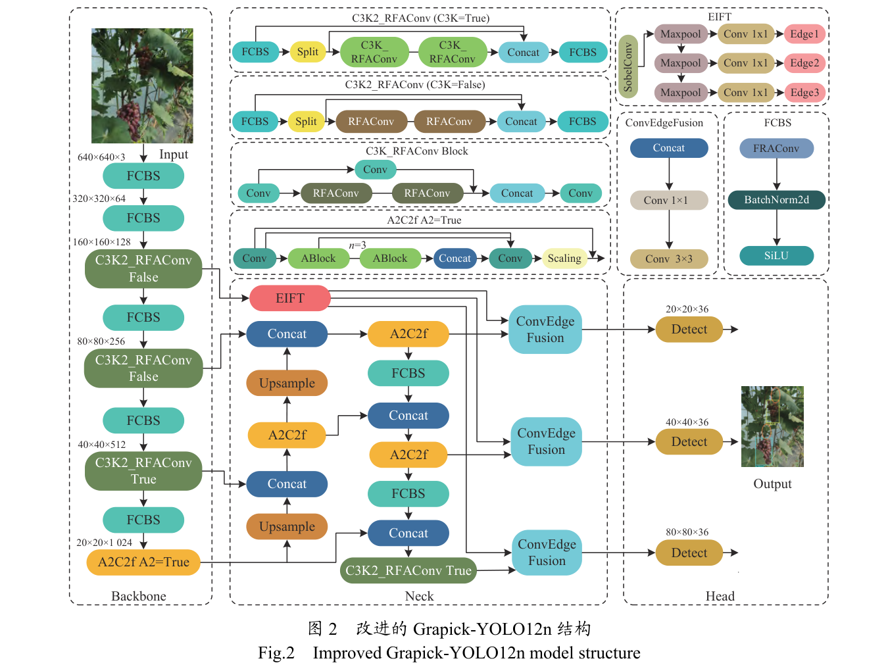

Grapick-YOLO12n 以 YOLO12n-pose 为基准，Backbone 负责分层提取特征，Neck 融合不同尺度的语义与细节，Head 输出果串成熟度、果梗及采摘点候选。EIFT 位于浅层并把 Edge1、Edge2、Edge3 注入不同层级的 ConvEdgeFusion，RFAConv 则嵌入 Backbone 与 Neck 的 FCBS 和 C3K2_RFAConv。网络输出的离散实例随后交给 RBPM，而不是分别运行两套独立检测器，由此形成“共享检测—规则匹配”的数据流。

### EIFT 多尺度边缘信息传递

EIFT 用于从浅层卷积特征中显式提取边缘，并将增强后的细节跨层传递至 Neck，其模块结构如下图所示。

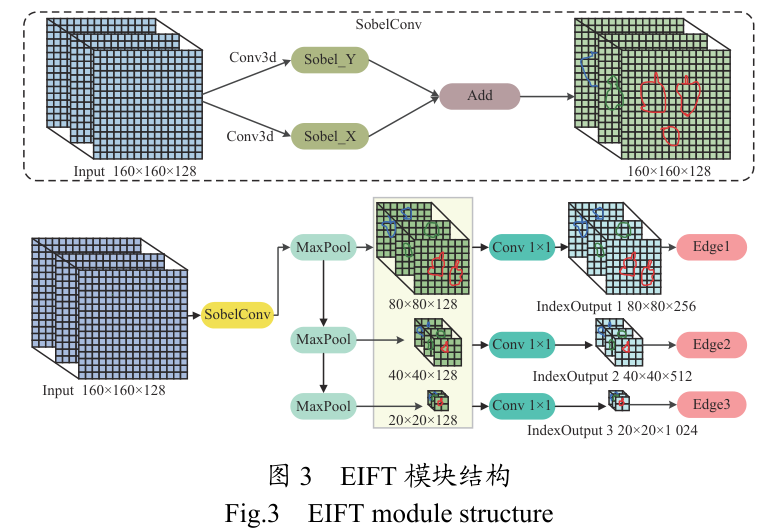

SobelConv 分别计算水平与垂直方向的梯度并叠加边缘响应，随后利用 MaxPool 保留局部最强响应，生成 3 个尺度的边缘特征。相比平滑特征的 AvgPool，这一选择更强调模糊果串轮廓与细长果梗的显著边缘。多尺度边缘经 Conv 1×1 调整后形成 Edge1、Edge2、Edge3，并分别送往 Neck 中对应分辨率的融合节点，为后续跨通道融合提供细节输入。

### ConvEdgeFusion 跨通道融合

ConvEdgeFusion 用于把主干卷积特征与 EIFT 边缘特征合并，其边缘生成、下采样和融合过程定义为：

$$
\begin{aligned}
E_i &= \mathrm{EdgeGen}_i(X), \quad i=1,2,\ldots,N \\
\hat{E}_i &= \mathrm{MaxPool}(E_i) \\
F_i &= \mathrm{Conv}_{\mathrm{fusion}}(X \oplus \hat{E}_i) \\
\tilde{X} &= \mathrm{Conv}_{1\times1}(F_i)
\end{aligned}
$$

其中，相关符号的含义如下表所示：

| 符号 | 含义 |
| --- | --- |
| $X$ | 输入浅层特征 |
| $E_i$ | 第 $i$ 个尺度的边缘特征 |
| $\mathrm{EdgeGen}_i$ | 第 $i$ 个尺度的边缘特征生成函数 |
| $\hat{E}_i$ | 下采样后的边缘特征 |
| $\oplus$ | 特征拼接操作 |
| $F_i$ | 拼接融合后的中间特征图 |
| $\mathrm{Conv}_{\mathrm{fusion}}$ | 跨通道融合卷积 |
| $\tilde{X}$ | 输出增强特征图 |

直观上，该过程先保留边缘强响应，再让网络学习边缘与语义特征的通道组合。ConvEdgeFusion 内部依次通过 1×1 卷积压缩并融合通道、3×3 卷积提取局部上下文、另一个 1×1 卷积调整输出维度，最终把增强特征送回 Neck 的对应层级，供后续检测头使用。

### RFAConv 双通道感受野建模

RFAConv 用于扩大特征提取的感受野，并协调空间重要性与局部感受野信息，其结构及原文所示的改进模块关系如下图所示。

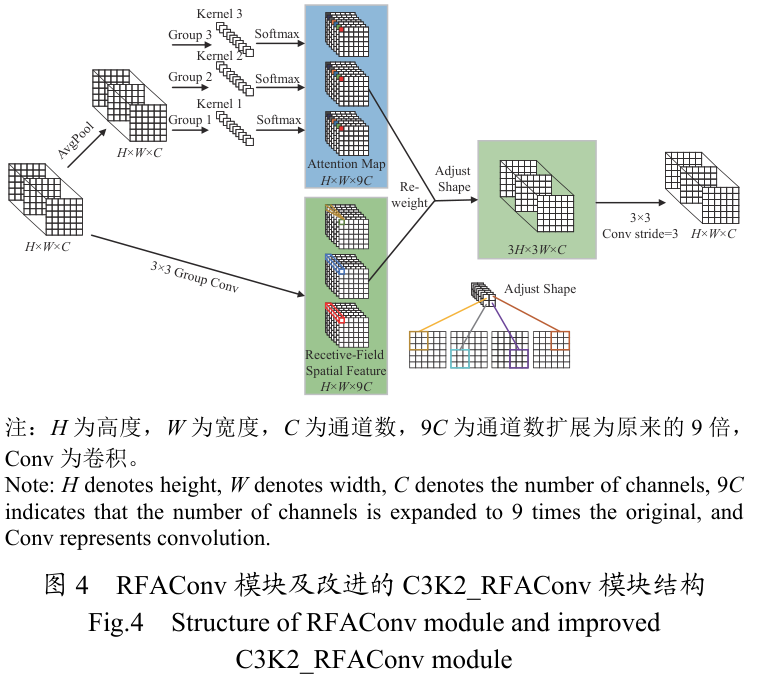

注意力通道通过全局平均池化、组卷积与 Softmax 生成空间注意力权重，感受野通道则利用组卷积、归一化和 ReLU 构建非线性特征表示。两路输出逐元素相乘后，再经步长为 3 的标准卷积调整尺度，使全局上下文与局部细节能够共同参与特征重标定。该模块接收 Backbone 或 Neck 的特征图，其输出继续进入后续卷积与特征融合单元，为多尺度果串和细小果梗提供更充分的上下文。

### C3K2_RFAConv 与 FCBS 模块替换

RFAConv 在整体网络中的落地方式是替换既有卷积组件，而非额外串联一条独立分支，具体对应关系如下表所示。

| 组件 | 替换方式 | 作用位置 |
| --- | --- | --- |
| FCBS | 以 RFAConv 替换标准 Conv2d 卷积层 | Backbone 与 Neck |
| C3K2_RFAConv（C3K=False） | 以 RFAConv 替换 Bottleneck 层 | Backbone 与 Neck |
| C3K2_RFAConv（C3K=True） | 以 C3K_RFAConv 替换原 C3K | Backbone 与 Neck |

这种改造保留 YOLO12n-pose 的层级数据流，同时让 RFAConv 的双通道机制作用于多个尺度。替换后的 FCBS 与 C3K2_RFAConv 和前述 EIFT 协同工作：前者扩大上下文感知范围，后者补充边缘细节，融合后的多尺度特征最终进入 Detect 层。

### RBPM 多重约束匹配

RBPM 用于把检测器输出的成熟果串与可见采摘点关联起来。原文未提供该算法的独立流程图，其核心规则可整理为下表。

| 规则 | 原文约束 |
| --- | --- |
| 位置约束① | 采摘点纵坐标高于果串检测框左上角顶点的纵坐标 |
| 位置约束② | 采摘点位于对应果串的检测框内 |
| 距离约束③ | 采摘点与果串上边框中心点的欧式距离小于 20 像素 |
| 组合关系 | 约束③必须满足；约束①与②为并集关系，满足其一即可，且①优先级高于② |

算法先建立成熟果串候选列表与可见采摘点列表，再遍历候选并计算距离、执行升序排序，随后依据多重约束筛选，最后为每个果串分配唯一采摘点。若遍历后没有满足条件的候选，则判定该果串不具备采摘条件。RBPM 接收 Grapick-YOLO12n 的检测结果，其输出的果串—采摘点匹配对构成整套方法的最终同步检测结果。

## 实验结果

### 实验设置

自建数据集包含 5 个葡萄品种、简单与复杂 2 类环境以及 4 种自然光照条件，共 4 383 张 RGB 图像，并按 6:3:1 随机划分为训练集、验证集和测试集。数据组成与规模如下表所示。

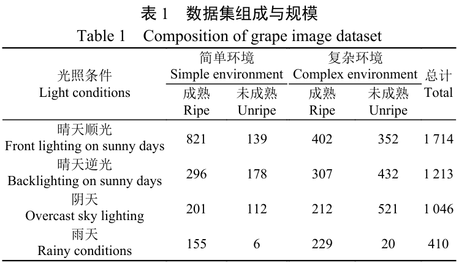

图像于 2025 年 6—8 月分 10 次采集，拍摄距离为 0.3～1.5 m；LabelMe 标注类别包括成熟果串 Frgc、未成熟果串 Urgc、果梗 stem 和采摘点 point。典型样本如下图所示。

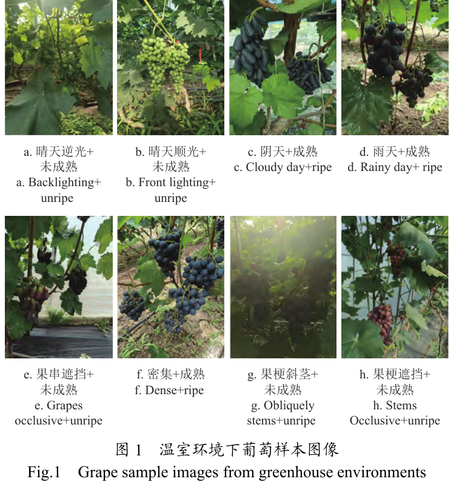

样本覆盖顺光、逆光、阴天、雨天以及密集、遮挡和斜茎等情况，能够对应方法所面向的复杂温室干扰。训练输入统一为 640×640 像素，训练 300 轮，采用动量 0.937 的 SGD 优化器与随机种子 0；评价包括 P、R、mAP、采摘点距离误差、FLOPs、参数量和 FPS，原文未给出这些指标的计算公式，本文不作补写。

### 可视化分析

不同模型在遮挡与密集场景中的定性结果如下图所示。

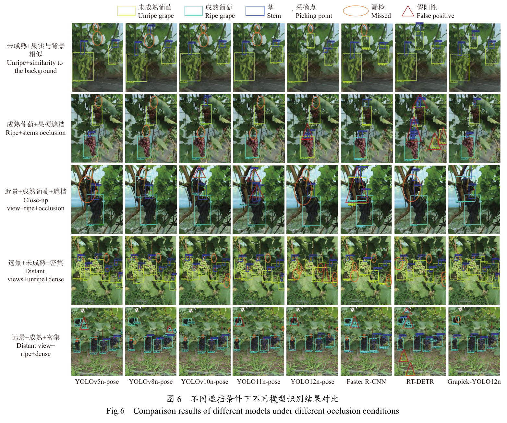

对比模型在远景密集、果梗遮挡及果实与背景相似时出现误检或漏检，Grapick-YOLO12n 的检测框更紧凑，对细果梗和成熟度的区分更准确。可见 EIFT 与 RFAConv 的联合改造不仅反映为指标变化，也直接改善了复杂场景中的目标定位与背景抑制。

### 不同光照条件结果

模型在 4 种光照条件下的果串成熟度与果梗检测结果如下表所示。

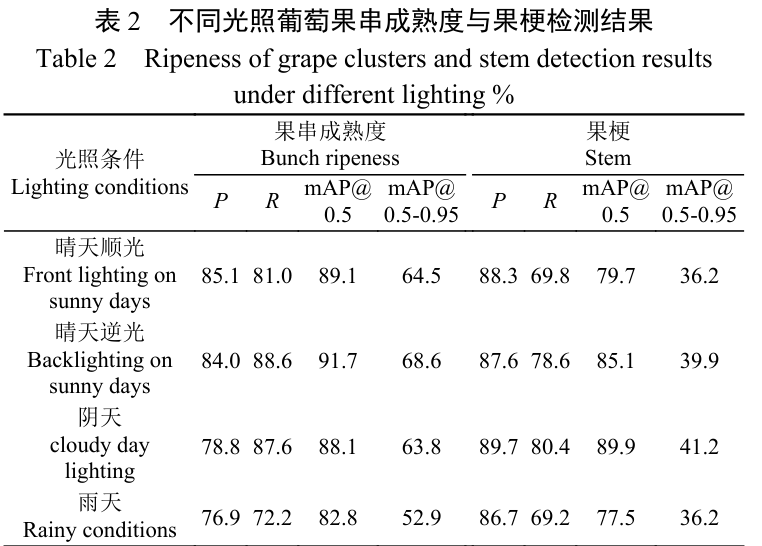

果串成熟度的 mAP@0.5 在晴天顺光、晴天逆光、阴天和雨天分别为 89.1%、91.7%、88.1% 和 82.8%，果梗对应结果为 79.7%、85.1%、89.9% 和 77.5%。阴天的果梗结果最高而雨天两项结果均下降，表明不同子任务对光照的敏感性并不一致，但模型在多种自然光照下仍保持了可用性能。

### 对比实验与训练过程

Grapick-YOLO12n 与主流检测模型的定量结果如下表所示。

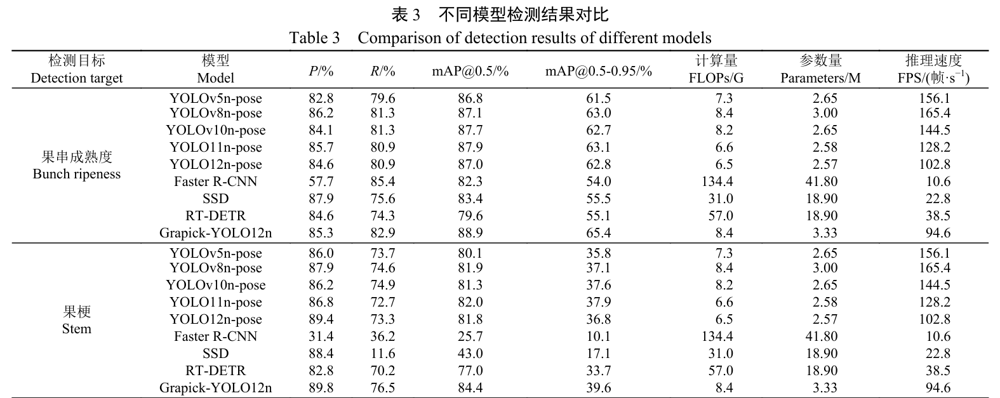

本文模型的果串成熟度与果梗 mAP@0.5 分别达到 88.9% 和 84.4%，较 YOLO12n-pose 提高 1.9 和 2.6 个百分点；参数量为 3.33 M，推理速度为 94.6 帧/s。可以看出，模型以高于 Faster R-CNN、SSD 和 RT-DETR 的推理速度取得了综合检测优势，但速度低于表中的其他 YOLO 对比模型。训练过程的损失与指标变化如下图所示。

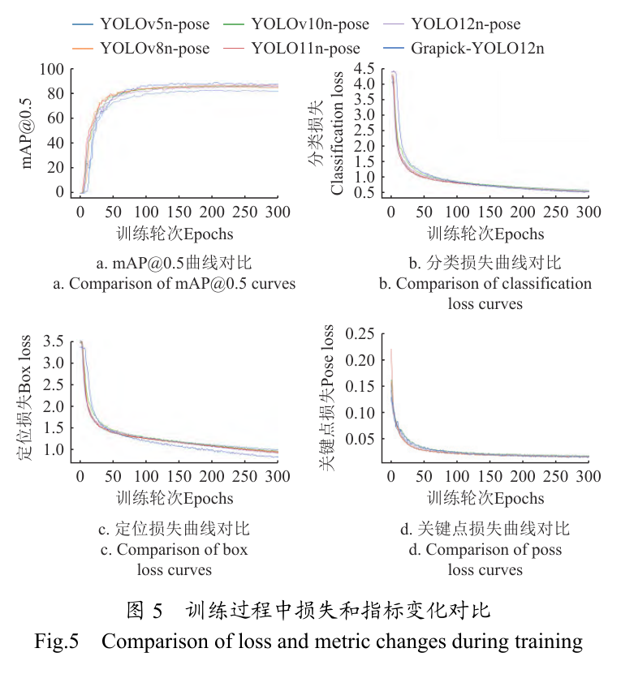

最终定位损失收敛至 0.834，较基准模型降低 9.1%，分类损失和关键点损失分别收敛至 0.532 和 0.016，并与基线基本持平。这表明两处模块改造主要改善了边界框定位，同时保持了成熟度分类与关键点学习的稳定性。

### 消融实验

EIFT 与 RFAConv 的逐模块及组合结果如下表所示。

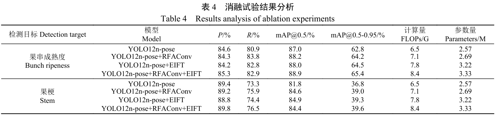

联合引入两个模块后，果串成熟度检测的 P、R 较基线分别提高 0.7 和 2.0 个百分点，果梗检测分别提高 0.4 和 3.2 个百分点，最终成熟度 mAP@0.5 为 88.9%、果梗 mAP@0.5 为 84.4%。单独使用 EIFT 时果梗 mAP@0.5 为 84.9%，联合模型则为 84.4%，说明原文消融结果并非所有单项指标都随模块叠加而上升，但联合模型的综合精确率与召回率更好。

### RBPM 匹配与采摘点定位

RBPM 在 10 张测试图像的 26 组可采摘果串与采摘点中成功匹配 25 组，而最近距离对比方法成功 20 组。不同模型的采摘点检测精确率和距离误差如下表所示。

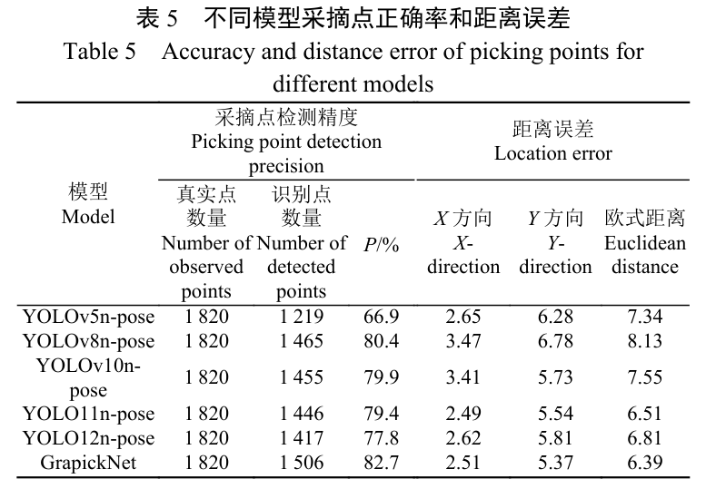

GrapickNet 在 1 820 个真实采摘点中识别出 1 506 个，精确率为 82.7%，X、Y 方向平均误差分别为 2.51 和 5.37 像素，欧式距离平均误差为 6.39 像素。原文换算的物理定位误差为 8.25～13.20 mm，处于采摘机器人末端执行器 15 mm 的容错半径内，表明匹配与定位结果能够满足该研究设定的作业要求。

### 采集设备与品种泛化

3 类采集设备各随机抽取 10 张图像进行测试，结果如下表所示。

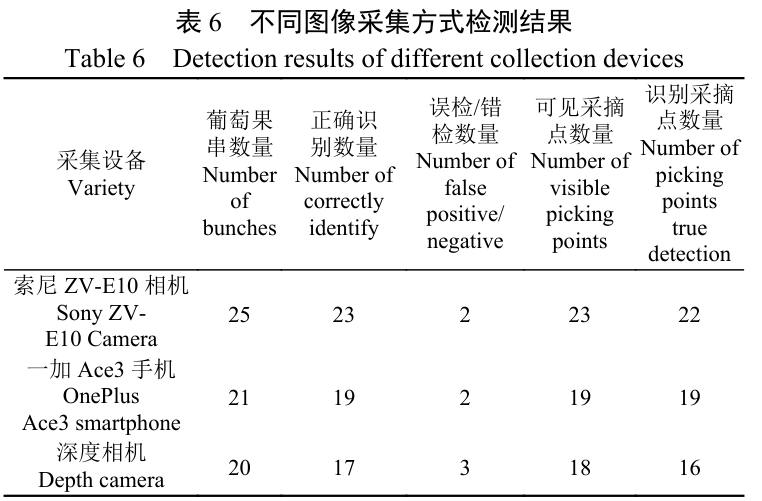

不同设备下成熟度与采摘点的平均检测精确率分别为 89.2% 和 94.9%，索尼 ZV-E10 相机整体表现最好，一加 Ace3 手机次之，深度相机相对较低。可见模型能够适配多种图像来源，设备成像质量与检测表现呈正相关。5 个品种的测试结果如下表所示。

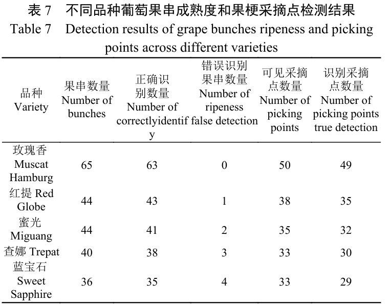

原文报告各品种葡萄成熟度与采摘点的平均检测精确率分别为 94.9% 和 92.1%，表明模型具有一定的跨品种识别能力。对应的同步检测可视化结果如下图所示。

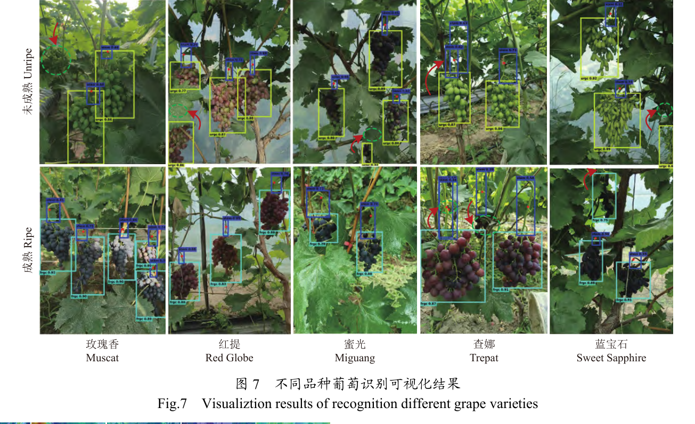

图中模型在多种光照、密集、遮挡和远景条件下均能输出果串成熟度与采摘点。漏检或重复检测主要集中于目标与背景高度相似、颜色失真、阴影或叶片完全遮挡的场景，与原文对不同品种结果的误差归因一致。

### 热力图与感受野分析

YOLO12n-pose 与 GrapickNet 的热力响应如下图所示。

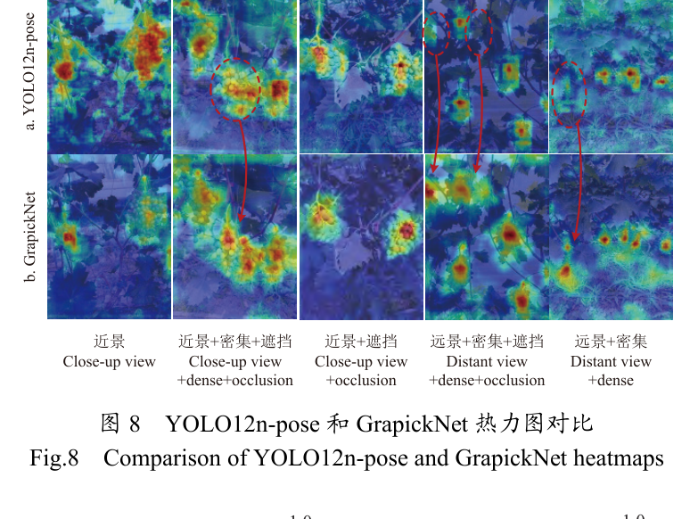

GrapickNet 对果串、果梗及采摘点区域的响应更集中，在部分遮挡、重叠与远景样本中尤为明显，说明改进模型能够更充分地关注有效目标区域。两种模型的感受野对比如下图所示。

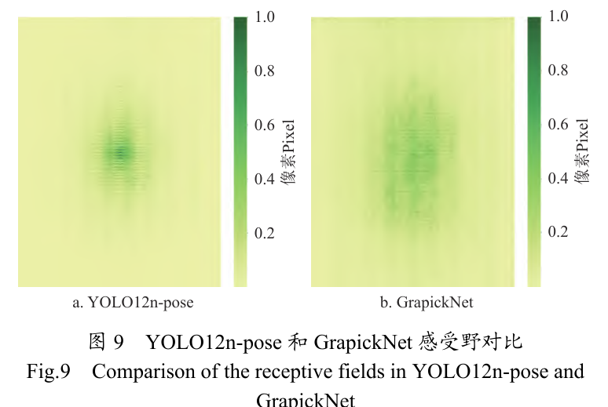

GrapickNet 在高阈值 0.99 下的高亮区域比例达到 0.9598，优于基准模型，感受野分布也更均衡、广阔。该现象与热力图结果共同表明，EIFT 的边缘传递和 RFAConv 的上下文建模增强了对多目标交织区域的特征感知。

## 优点和创新点

个人认为，本文有如下一些优点和创新点可供参考学习：

1. 将成熟度、果梗与采摘点候选纳入同一 YOLO12n-pose 框架，再以 RBPM 完成空间关联，把分离的多阶段流程转化为共享特征的同步检测流程。
2. 通过 EIFT 的显式边缘传递与 RFAConv 的双通道感受野建模，分别强化模糊轮廓和多尺度上下文，对密集遮挡与细小果梗的识别具有针对性。
3. 在多品种、多光照自建数据集上开展遮挡、消融、设备与品种实验，并报告 3.33 M 参数量、94.6 帧/s 及采摘点定位误差，兼顾证据链完整性与部署参考价值。
